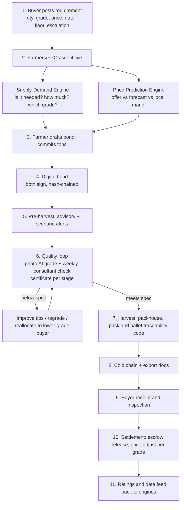

# AgriLink — End-to-End Flow Structure

Corridor: **India (Konkan/Nashik FPOs) → Singapore**. Product: **Alphonso mango** (perishable, short shelf life, grade-sensitive). Pillars: **consistency · quality · reliability**.

## 1. Actors
| Actor | Role |
|---|---|
| Buyer (Singapore importer/retailer) | Posts requirement, signs bond, pays, accepts delivery |
| Farmer | Grows, uploads photos, signs bond (usually through FPO) |
| FPO | Aggregates farmers, packhouse, export paperwork, field consultants |
| FPO field consultant | Weekly farm visit; human check on AI grading |
| Platform | Matching, forecasting engines, digital bond, certificates, alerts |
| Logistics partner | Cold chain, airfreight/sea, customs (APEDA registration, phytosanitary, VHT/irradiation) |

## 2. Lifecycle (stages)



| # | Stage | System behaviour | Status in repo |
|---|---|---|---|
| 0 | Login + farm profile | Mobile + OTP; farm details drive a personalised dashboard (yield, harvest window, capacity) | **built** |
| 1 | Requirement | Buyer form; live price hint vs forecast | **built** |
| 2 | Discovery | Farmer sees requirements, filters by grade, compares vs forecast & mandi | **built** |
| 3a | Supply–Demand engine | Trained ML model: need / quantity / grade / month per market, FPO supply gap, personal plan, live buyer signal | **built** (trained on sample data until APEDA CSVs are loaded) |
| 3b | Price (cost) prediction | Trained ML model: weekly market price per district × grade, demand scenarios, fair export offer; every buyer offer → accept / negotiate (counter-offer) / sell locally | **built** (trained on sample data until Agmarknet history is loaded) |
| 3c | Cost & Profit study | Trained cost model: year-by-year cost vs price vs profit, farm cost & break-even, AgriLink vs local channel, what-if, my costs vs district | **built** (sample data) |
| 3d | Check before you sign | Demand + price + profit + capacity + weather verdict for one deal, before committing and before signing | **built** |
| 4 | Bond | Draft -> both sign -> active; capacity check; SHA-256 chained signatures; verify | **built (server-side)** |
| 5 | Scenario / alerts | Proactive weather alerts with actions; not Q&A | **rules built**, weather feed stub; spec `docs/modules/scenario-alerts.md` |
| 6 | Quality loop | Photo -> size/colour/blemish -> grade vs buyer spec; consultant override | **rules built** (manual inputs); photo model TODO; `docs/modules/quality-grading.md` |
| 7-8 | Traceability & logistics | Lot code QR, temperature log, document checklist | spec `docs/modules/logistics-traceability.md` |
| 9-10 | Settlement | Escrow 30/70, auto price adjust to delivered grade | clause text in bond; engine TODO |
| 11 | Feedback loop | Actual grade/price/rejections retrain forecasts and reliability scores | TODO |
| – | Multilingual bot | SMS/WhatsApp in Marathi/Hindi/English: alerts, bond status, tips | spec `docs/modules/chatbot.md` (app UI already en/hi/mr) |

## 3. Bond state machine
```
draft -> buyer_signed -> active
draft -> farmer_signed -> active
draft -> declined (removed)
active -> delivered -> settled | disputed
```
`active` triggers: fill count on the requirement increases, escrow instruction, quality schedule starts.
Signature hash = SHA-256(terms JSON + side + timestamp + other side's hash). Editing terms after signing breaks verification.

## 4. Consistency · Quality · Reliability — how each is delivered
| Pillar | Mechanisms |
|---|---|
| **Consistency** (same spec every shipment) | Buyer spec encoded as machine-checkable grade rules; lot-level photo grading; blending/regrading at packhouse; farmer reliability score; forecast of supply so FPO books only what it can fill |
| **Quality** | Photo AI + weekly consultant visit (human-in-loop); stage certificates (pre-harvest, harvest, packhouse, pre-ship); improvement tips when below grade; irradiation/VHT compliance tracking |
| **Reliability** (shipment arrives as promised) | Binding bond + escrow; weather/storm alerts with actions; cold-chain temperature logs; fallback allocation (reroute lower-grade lots to local/processing); on-time delivery & rejection history = trust score visible to both sides |

## 5. Fixing the "scenario lab" gap
Farmers already know how to react to storms. So drop the "ask what-if" framing and instead:
1. **Push** alerts before the event (IMD/forecast feed) with *specific* actions: harvest-now list per plot, pack-house capacity booking, netting/bagging reminders.
2. **Quantify** impact on the signed bond: "this rain risks 3 t of Grade A; Option: harvest 2 t early, notify buyer of 1 t shortfall".
3. **Automate** the paperwork: force-majeure notice, insurance claim evidence (geo-tagged photos), re-allocation proposal to another buyer.
What-if sliders stay only as a planning tool for the FPO (season planning), not for farmers in a crisis.

## 6. Data model (core entities)
`Requirement{id,buyer,variety,grade,tons,price,floor,date,escalation,filled}` ·
`Bond{id,reqId,buyer,farmer,grade,tons,price,date,terms,status,sigs{buyer,farmer}}` ·
`Lot{id,bondId,farmerIds,plot,photos[],grade,certs[],tempLog[]}` ·
`Alert{id,plot,type,severity,actions[]}` · `Rating{partyId,onTime,rejectRate}`

## 7. Architecture
See `ARCHITECTURE.md`. Today: React client -> Express API + MongoDB -> Python FastAPI (forecast, grading, alerts).
Later: notification service (SMS / WhatsApp), photo-grading model, hash anchoring or e-sign vendor for bonds.
